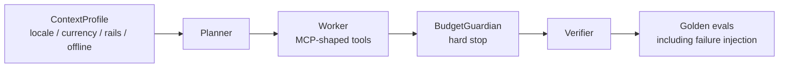

# AgentBridge Africa

<p align="center">
  <strong>Multi-agent bridge with hard budgets and regional context</strong><br/>
  ContextProfile · BudgetGuardian · Golden trajectory evals<br/>
  for African payment rails and operating environments
</p>

[]()
[]()
[]()

---

## What problem does this solve?

Agent systems interacting with real rails need hard cost ceilings, local context, and failure-mode safety. Soft retries become infinite. AgentBridge makes budget a hard stop and evaluates every change against golden trajectories before expansion.

## Architecture



**Stack:** Python 3.11+ · Pydantic v2 · PyYAML · pytest  
Eval harness runs fully offline.

## What is implemented

- ContextProfile (en-NG, en-KE, offline-NG)
- BudgetGuardian hard stop
- MCP-shaped envelopes with safety hints
- Golden YAML trajectories + failure injection
- Payments adapter (quote / execute / status)

## Quick start

```bash
pip install -r requirements.txt
make eval
```

## Demo

<!-- asciinema + agg recommended for CLI; screencli for future web UI -->

> Demo GIF coming soon. Run `make eval` to see 100% on expected outcomes.

## Portfolio value

Production-minded agent design for African contexts: hard budgets, regional profiles, deterministic evals.

## Limitations

Planner is deterministic. Live multi-rail adapters are stubbed for eval safety.

## Companion repositories

- [ArchAudit-CCM](https://github.com/Logonotobscurity/ArchAudit-CCM)
- [GigPilot](https://github.com/Logonotobscurity/GigPilot)

## Visual assets checklist

- [ ] Social preview (1280×640)
- [ ] Demo GIF of eval harness
- [ ] Logo in `docs/assets/`
