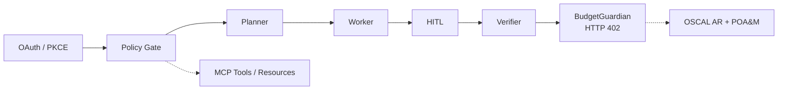

# AgentBridge Africa

[](https://opensource.org/licenses/MIT)
[](https://www.python.org/)
[](https://modelcontextprotocol.io/)
[]()

**Hardened multi-agent bridge for African payment rails.**  
Policy-gated tool execution, human-in-the-loop approval, hard budget stops, and auditable evidence — not a generic chatbot.

<!-- Banner / logo placeholder: add docs/assets/banner.png (transparent PNG, works in dark/light) -->
<!-- Demo GIF: place a 5-15s recording of the operator console or eval run here, 600-800px wide -->

> Local-context first (locale, currency, rails, connectivity).  
> Default execution is sandboxed. Live connectors require deployment-owned secrets, policy, and egress configuration.

---

## What problem does this solve?

Agents that interact with real payment systems must be constrained. Unrestricted tool calling creates unbounded cost, unauthorized transfers, and weak audit trails. AgentBridge Africa enforces explicit permissions, human approval for destructive actions, hard budget limits, and machine-readable compliance evidence before any side effect is allowed.

## What is implemented

- Planner → worker → verifier orchestration with checkpointing.
- Native MCP tool contracts with `readOnly` / `destructive` / `idempotent` annotations.
- Policy gate (allow / block / escalate) and human-in-the-loop interceptors for destructive tools.
- `BudgetGuardian` that hard-stops with HTTP 402 and writes partial OSCAL evidence.
- Circuit breakers, provider routing, and OpenTelemetry-shaped traces.
- OSCAL Assessment Results + Plan of Action & Milestones export.
- Golden-trajectory eval harness + production-trace sampler.
- Context profiles for Nigerian and Kenyan rails (including offline-first fail-closed behavior).
- Operator console (Next.js) demonstrating approval workflow and audit visibility (currently mocked data).

## Architecture



Key components live in `agentbridge/core/` (orchestrator, policy, budget, HITL, rail switching), `agentbridge/tools/` (annotated MCP contracts + sandbox adapter), `agentbridge/payments/` (live-ready packs for M-Pesa/Daraja, Paystack, MTN MoMo), and `agentbridge/compliance/` (OSCAL exporter).

## What a reviewer can run

```bash
python3 -m venv .venv && source .venv/bin/activate
pip install -r requirements.txt
make eval          # golden trajectories
python -m pytest -q
# Optional live connector transport (still requires deployment secrets)
pip install '.[connectors]'
```

Discovery (no credentials required):
```bash
cat .well-known/mcp.json
```

Operator console (demo data):
```bash
cd frontend && npm install && npm run dev
```

## Evidence that it works

| Metric | Latest sandbox result | Source |
|--------|-----------------------|--------|
| Golden trajectory success | 7 / 7 (100%) | `make eval` |
| Budget hard-stop | HTTP 402 + partial OSCAL | `BudgetGuardian` + tests |
| Destructive tool gating | HITL required; idempotency key enforced | Policy + HITL modules |
| Audit artifacts | OSCAL AR + POA&M generated on control failure | `compliance/oscal_exporter.py` |

## Honest limitations (important for interviews)

- Operator dashboard data is currently mocked; approval actions update local UI state only.
- Payment adapters include sandbox behavior; live execution depends on deployment-owned secrets and configuration.
- Present this as a security-conscious architecture and working prototype, not a production payment processor.

## Portfolio value

Strongest evidence for agent orchestration, operational controls, secure tool execution, and financial workflows.  
Best suited for: M-KOPA (AI Agents / AI Operations), Kredete (Agentic Systems), Scale Army (Forward Deployed AI Engineer), Vennote, AfCEN.

## Further reading

- `DEVELOPMENT.md` — principles and definition of done
- `docs/architecture.md`, `docs/production-architecture.md`, `docs/mcp-safety.md`, `docs/oscal.md`
- Audits in `docs/audits/`

## Visual assets to add

1. Banner / logo in `docs/assets/` (transparent PNG, dark/light compatible).
2. Demo GIF (5–15 s) of the operator console approval flow or `make eval`.
3. Social preview image (1280×640) via repo Settings → Social preview.
4. Screenshots of the operator dashboard next to relevant sections.
