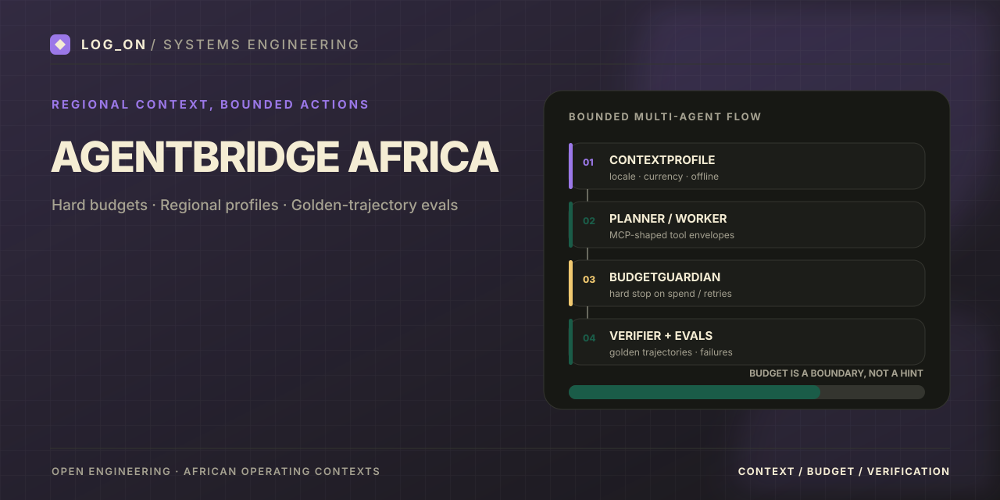

# AgentBridge Africa

<p align="center">
  
</p>

[]()
[]()

**Multi-agent bridge with ContextProfile, hard budget stops, and MCP-shaped African payment adapters.**

Golden trajectory evals, offline failure modes, and regional profiles (en-NG, en-KE) so agent systems stay predictable in African operating environments.

---

## What problem does this solve?

Agent workflows lack hard cost ceilings, local context, and reliable regional tool adapters. Soft failures turn into infinite retries. AgentBridge enforces budget as a hard stop and evaluates against golden trajectories before expansion.

## What is implemented

- ContextProfile (locale, currency, rails, cost caps)
- BudgetGuardian hard stop
- MCP-shaped tool envelopes with safety hints
- Golden YAML trajectory harness (including failure injection)
- Profiles: en-NG, en-KE, offline-NG
- Payments adapter (quote / execute / status)

## Architecture / stack

Python 3.11+ · Pydantic v2 · PyYAML · pytest  
Eval harness runs fully offline.

## What a reviewer can run

```bash
pip install -r requirements.txt
make eval
```

## Reproducible terminal demo

Run the offline golden-trajectory evaluation harness:

```bash
pip install -r requirements.txt
make eval
```

Run `make test` for the full automated checks. Live payment-rail adapters are stubbed for evaluation safety; this demo is not a live payment transaction.

For a short recording, capture `make eval` with [asciinema](https://asciinema.org/), then convert the cast to a compressed GIF with [agg](https://github.com/asciinema/agg). Verify the output and remove secrets before publishing.

## Social preview

The README banner is stored at `docs/assets/social-preview.svg`. To set the card shown when the repository link is shared, upload the matching 1280×640 PNG through **Settings → General → Social preview**. This setting is separate from the README banner.

## Portfolio value

Evidence of production-minded agent design: hard budgets, regional context, and deterministic evals instead of demo-only loops. Companion to ArchAudit CCM.

## Limitations

Planner is currently deterministic. Full multi-rail live adapters are stubbed for eval safety.

## Companion repositories

- [ArchAudit-CCM](https://github.com/Logonotobscurity/ArchAudit-CCM)
- [GigPilot](https://github.com/Logonotobscurity/GigPilot)
