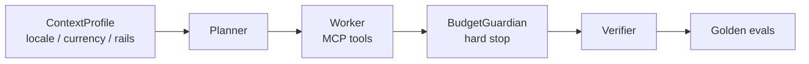

# AgentBridge Africa

<p align="center">
  <strong>Multi-agent bridge with hard budgets and regional context</strong><br/>
  ContextProfile · BudgetGuardian · Golden trajectory evals
</p>

[]()
[]()
[]()

---

## What problem does this solve?

Agent workflows lack hard cost ceilings, local context, and reliable regional tool adapters. Soft failures turn into infinite retries. AgentBridge enforces budget as a hard stop and evaluates against golden trajectories before expansion.

## Architecture



**Stack:** Python 3.11+ · Pydantic v2 · PyYAML · pytest  
Eval harness runs fully offline.

## What is implemented

- ContextProfile (locale, currency, rails, cost caps)
- BudgetGuardian hard stop
- MCP-shaped tool envelopes with safety hints
- Golden YAML trajectory harness (including failure injection)
- Profiles: en-NG, en-KE, offline-NG
- Payments adapter (quote / execute / status)

## Quick start

```bash
pip install -r requirements.txt
make eval
```

## Demo

<!-- Placeholder for screencli / terminal recording -->
<!-- Record with: npx screencli record <docs-url> -p "Run the eval harness and show budget hard stop" -->

> Demo GIF coming soon. Run `make eval` to see the golden trajectory results.

## Portfolio value

Evidence of production-minded agent design: hard budgets, regional context, and deterministic evals instead of demo-only loops. Companion to ArchAudit CCM.

## Limitations

Planner is currently deterministic. Full multi-rail live adapters are stubbed for eval safety.

## Companion repositories

- [ArchAudit-CCM](https://github.com/Logonotobscurity/ArchAudit-CCM)
- [GigPilot](https://github.com/Logonotobscurity/GigPilot)

## Visual assets to add

1. Social preview image (1280×640).
2. Demo GIF of eval harness output (asciinema recommended).
3. Static architecture diagram if needed.
